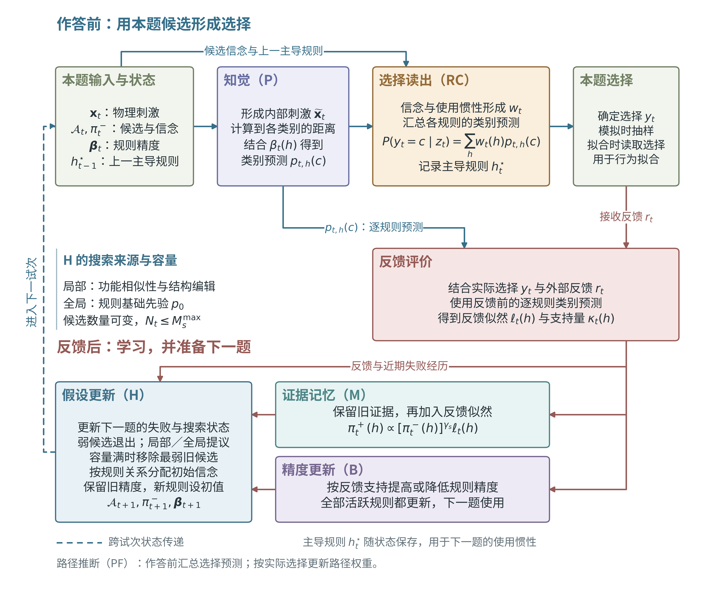

# Model 0923：保持 0826 表现的机制改进

模型：`model_0923`；当前完整模型：`full`；机制规范：`0923-full-v2`。



**图1｜机制总览。** 知觉模块形成内部刺激，各条规则的类别预测供选择读出和反馈评价共用。
选择读出汇总作答概率。收到反馈后，证据记忆与精度更新并行调整规则信念和预测精度，
假设更新为下一题准备候选。虚线表示跨试次状态传递。
选择数据用于估计参数和更新粒子权重。
图示为当前修订设计。
图中反馈更新以二值任务为例，条件3还包含反应配对学习。
绘图源文件为 [model_0923_framework.py](../../../../CategoryLearning_codes/figures/model_architecture/model_0923_framework.py)。

**2026-10-11 规则目录更新：** 四分类已由128条扩为152条，两组新增规则及二分类共用设置见第12节。二分类保持29条。

0923 是待检验的新版本。0826 的代码路径、配置、文稿和既有结果均保留；
目前不能声称 0923 更好，也没有因改名而将 0826 的拟合参数当作 0923 的估计。

## 0. 当前目标与已有实现的区别（2026-10-05）

用户明确当前优先目标：**用稍微更合理、机制更好解释的模型，达到与 0826
相当的模型效果。** 工作以已有 0826 为参照，针对具体设计问题逐项改进。
参数更少、机制更少和证明最简 B0 是否足够，都不作为当前主任务。

本文件第 3 节仍准确描述已经实现的 B0 v2；它保留为现有候选，不能据此认定
最终 0923 必须采用固定精度、无持续执行、固定搜索范围或单候选替换。
也不要求先完成 B0 拟合并证明其不足，才能在改进版中保留 0826 的相关能力。
当前只有 B0 可执行；本次目标更新没有改变代码、配置、拟合参数或已有结果。

后续设计优先区分“保留机制功能”和“调整实现方式”。例如，保留规则使用的
持续性，同时研究执行切换与候选替换的解耦；保留证据积累与精度变化的能力，
同时明确二者各自更新什么；检查替换弱候选为何会扰动保留规则的信念。
这些是待讨论的改进方向，不因本次目标更新自动采用某个新方程。
规则目录的已有修订继续保留，区域—类别关联学习仍待定义。

“相当效果”后续至少分别核对逐题选择预测，以及主要学习
过程的重现情况；具体指标和容忍范围需在比较前确定，不要求复刻 0826 的潜在轨迹。
对照保持数据、计分试次、可用历史和数值精度可比，按被试及 condition 检查退化，
避免只看合并总分。
本目标不要求新版显著优于 0826 的拟合分数；表现保持和所改机制的解释改善应分别交代。
完整拟合仍需另行安排，本次没有启动。

同日后续修复：共享 BetaModule 已修正多分类二值反馈的精度支持基准，四分类正确／错误
分别以 0.25／0.75 为中性点；公式和旧结果边界见 [condition 2 更新说明](model_0826_condition2.md)。
0826 condition 2 的新运行采用该修复。当前 0923 B0 的精度增减率均为零，因此仍为固定精度，
没有借此启用 B3，也没有改变 B0 的其他机制。

## 1. 本轮交付与尚未完成的部分

目前完成最简行为核心、三个 condition 的配置；12条重复特征规则经独立检查和用户确认，
已接入正式B0（第10、11节）。尚未拟合0923被试参数，也未选出最终机制组合。

当前 0923 行为核心使用29条二分类 / 152条四分类目录。四分类先从116条增加到128条，
本次再加入两组各12条规则（第12节），相似度按完整目录计算。采用依据是用户确认的表示设计，
尚未通过拟合比较证明改善；0826 和保存的 0923 B0 v1 配置仍使用旧目录。
目录覆盖与被试实际使用的规则分别评估。

## 2. 需要解释的现象

快速改善、缓慢渐进、长期停滞后明显改善是预测目标，不是输入模型的被试身份。
学习速度和曲线形状分别记录，不强行把每个人分入三个互斥组。
一次达到正确率标准也不等于以后永久掌握。

| 现象 | B0 可检验的解释 |
|---|---|
| rapid | 较早考虑到有效规则，证据较快集中 |
| slow and gradual | 候选支持缓慢变化或候选逐步修订 |
| slow but abrupt | 晚发现有效规则，或已有候选的支持随后占优 |

S122/S206/S215 是既有行为规则选出的开发案例，不据其模型轨迹指定解释。
全部 12 人（每 condition 四人）均保留，包括不明确偏向渐进或阶跃的记录。
既有分类未控制全部刺激难度与时间依赖，不能直接等同于认知类型。

## 3. B0 的逐试次过程

可理解为：保留少量解释 → 用已有反馈决定是否修订 → 根据当前支持作答 →
接收反馈 → 更新证据。

### 3.1 有限候选与证据

工作空间 $A_t$ 保存 $M_s$ 个候选；$\pi_t^-(h)$ 是当前选择前对候选的相对支持。
为减少第一步改动，仍沿用固定满员空间和均匀初始候选抽样。
这不意味着已测得真实工作记忆容量，也未证明简单规则和复杂规则认知成本相同。

每个活跃规则依据知觉刺激产生类别概率 $p_h(y\mid x_t)$。知觉噪声沿用学习前的
被试知觉测量。规则精度固定为 $\beta_{0,s}$，不在 B0 中随反馈变化。

反馈后保留一条证据记忆：

\[
\pi_t^+(h)\propto[\pi_t^-(h)]^{\gamma_s}L_t(h),\qquad 0\leq\gamma_s\leq1.
\]

反馈增益为 1，静态永久记忆权重为 0。Condition 3 对规则与未知配对的联合分布
使用相同的遗忘原则，然后取规则边际；不另设配对遗忘参数。

### 3.2 统一的失败控制

只读取已经完成的反馈，且不在 session 边界暗中重置状态：

\[
F_t=0.6F_{t-1}+0.4(1-r_{t-1}),\qquad F_1=0,
\]

\[
E_t=\operatorname{sigmoid}\{\operatorname{logit}(E_{0,s})+a_s F_t\},
\qquad a_s\geq0.
\]

两版本后续比较均先固定 $\delta_F=0.6$。0923 不再分别估计正确后和错误后的基线。
$E_{0,s}$ 是没有失败积累时的基线，$a_s$ 是失败的推动程度。
即使 $a_s=0$，诊断仍保存正确的 $F_t$，但它不影响选择或搜索。

对 condition 3，控制器直接使用原分值：错误、部分正确、完全正确分别贡献
1、0.5、0 的失败量。这是“按得分损失加权”的简洁假设，**不是信息量或惊讶度**。
它有别于 0826 控制器将 0 和 0.5 都作为非完全成功；原三值反馈另用于精确证据更新。
不预先规定部分正确反馈一定保护哪一层规则。

第一题只初始化工作空间，没有替换事件，实际替换概率记为 0；$E_0$ 从后续题起生效。

### 3.3 每次最多修订一个候选

对 $t\geq2$：

\[
K_t\sim\operatorname{Bernoulli}(E_t),\qquad K_t\in\{0,1\}.
\]

没有第二次独立搜索掷币，也不使用多槽位二项替换。
发生修订时，沿用权重 $1-\pi_{t-1}^+(h)+\epsilon$ 从旧候选中移走一条。
所有候选都允许移走；不存在受保护的执行槽位。

局部提议仍围绕整个旧信念分布，通过既有功能相似度生成；全局提议使用基础先验。
二者以固定于被试内的 $g_s$ 混合。局部宽度 $\tau_L=0.10$；B0 不让失败额外扩大范围。
新候选来自更新前不活跃的规则；“新”仅指当前不在空间内，允许在之后重新想到旧规则。

继承的功能相似度是暂定参照，描述两条规则的分类结果有多接近。
相似度资源、标签偏好、目录条目数造成的先验偏好都需要在规则表示审查中核对。

### 3.4 不扰动保留规则的信念质量

无修订时，$\pi_t^-=\pi_{t-1}^+$。移走 $d$、补入 $u$ 时：

\[
\pi_t^-(h)=\pi_{t-1}^+(h)\ (h\text{ 为保留规则}),\qquad
\pi_t^-(u)=\pi_{t-1}^+(d).
\]

例如 $(0.89,0.10,0.01)$ 中第三条被替换，保留两条仍为 0.89 和 0.10，新人获得 0.01。
只保留一个新人时，共享的 mass-preserving transport 精确退化为这个公式。
它不使新人获得强支持，后续需要反馈积累；若妨碍数据中的快速发现，应作为明确不足检验。

Condition 3 同时保留旧规则的联合配对质量，新规则的条件配对分布沿用共享的
局部/全局投影初始化。这仍是一个迁移假设；$g_s$ 在该条件下也影响新人的配对初始化，
不能把它宣称为完全纯粹的搜索距离参数。旧规则的联合质量不因这个投影而重置。

### 3.5 作答无独立执行门槛

最小生成解释：本题按 $\pi_t^-$ 调用一个规则，并按该规则作答。
只拟合选择时，将本题规则边缘化：

\[
P(y_t\mid x_t,\mathcal D_{<t})=\sum_h\pi_t^-(h)p_h(y_t\mid x_t).
\]

已有候选每题都可以影响选择，不要求先引入新人，不使用固定 20% 切换事件。
B0 不保持独立的跨题执行状态；不是把混合选择概率解释为人能同时执行所有规则。
不增加输出 lapse、隐含阶段切换或单独掌握状态。

### 3.6 当前参数与固定约定

| 量 | 作用 | 当前示例配置 |
|---|---|---:|
| $M_s$ | 候选槽位数 | 3 |
| $\gamma_s$ | 旧证据保留 | 0.80 |
| $E_{0,s}$ | 基线修订概率 | 0.05 |
| $a_s$ | 失败推动修订 | 1.0 |
| $g_s$ | 全局提议混合比例 | 0.20 |
| $\beta_{0,s}$ | 固定规则精度 | 5.0 |

六个量是未来可估计的被试参数；表中数值只让实现可运行，不是拟合结果或最终参数范围。
$\delta_F=0.60$、$\tau_L=0.10$ 和 $\epsilon=10^{-12}$ 固定。
容量仍受共享空间“至少同样多非活跃候选”的实现约束；未新增大容量认知假设。
正式搜索范围、数值精度和恢复方案需在后续参数估计步骤冻结，不能把 smoke 默认值直接投入正式比较。

## 4. 三个 condition 共用什么、区别在哪里

| condition | 实验名称 | 必须保留的输入语义 |
|---|---|---|
| 1 | Task1 | 两分类、二值反馈 |
| 2 | Task3 | 四分类、二值反馈；无事先告知的层级知识 |
| 3 | Task2 | 四分类、0/0.5/1 反馈；已告知两科各两种，但未知反应配对 |

两个四分类任务的目标分类结构相同，反馈和事先知识不同。
学习算法不读取 rapid/gradual/abrupt 标签，也不能从真实 category 初始化正确规则或配对。
Condition 3 使用 `hierarchical_pairing` 和 `HierarchicalPairingMemoryModule`，
三个配对从均匀状态开始。`choice`、`presskey`、`category` 按既有数据契约区分。

## 5. 规则表示修订的范围约束（2026-09-23 用户确认）

取消四分类的 24 种标签全排列方案。标签编号变化不作为新增规则候选，
也不以延迟枚举、槽位内排列分布等方式保留整套 24 种映射。
当前 B0 仍使用原固定标签；这里记录后续设计约束，不声称标签缺口已经解决。

已采用的表示修订：在有限目录内允许同一特征参与多个判断（第 11 节）。
核实物理尺度后单独检验明确的加权和运算。
各项逐步检验。

标签问题的轻量候选是在活跃划分结构内维护“区域到反应类别”的关联权重，
结构目录不因标签扩张。关联权重是根据历史反馈更新的状态，不是逐题自由拟合参数。
这是待定义、待检验的替代方向，尚未采用或实现。
若独立维护各区域的类别关联，就不再严格保证一一对应，可能允许学习早期多个区域
暂时指向同一类别；不能把它称为对 24 种排列的等价计算简化。
必须先明确二值/三值反馈下的更新与现有配对状态的关系，禁止读取真实类别初始化。

## 6. 已记录的机制候选与当前状态

下表保留 B0 开发时登记的候选与可检验现象。按第 0 节的新目标，执行持续性和
精度学习可从 0826 的能力出发改进，无需以 B0 拟合失败作为讨论或实现的前置条件。
候选名称不代表最终改进版必须逐个实现或依次叠加。

| 候选版本 | 可用于检验的现象 | 当前状态 |
|---|---|---|
| `B1_structural_revision` | 稳定的局部特征/运算/分支修订不能由功能相似度预测 | 未实现 |
| `B2_execution_inertia` | 控制证据后仍有额外的规则使用持续性或切换迟滞 | 0923 未实现；0826 已有持续执行，但解耦设计仍待确定 |
| `B3_precision_learning` | 可比较刺激上判断规则稳定而准确率继续改善 | 0923 未接入；0826 已有动态精度 |
| `B4_directed_hierarchy` | 正确的三值反馈更新仍解释不了保留一层、修改另一层 | 未实现；不向模型泄漏正确配对 |

执行惯性的候选可让“继续使用上次规则”获得额外偏好，但切换仍每题可发生，
不再与新人出现绑定。结构化修订先作为现有局部提议的替代，避免不必要地叠加两套近邻核。
不同扩展先单独检查；只有发现必要的交互才组合，不一次扫描所有机制组合。
当前配置守卫只接受 `B0`，不会将尚未实现的候选标签当作可运行模型。

## 7. 采用模型的证据规则

1. 每项改动先明确 0826 中要改善的具体假设、机制耦合或行为预测失配，以及需要保留的能力；不能因潜在曲线更好看而加机制，也不因追求最简而预先删除相关能力。
2. 用真实逐题选择预测评价，不用新旧控制曲线的相似程度决定版本。
3. 按被试和条件分别评分，同时报告改善与下降。
4. 控制数据、计分试次、规则表示、可用历史、优化预算与数值误差。
   B0 同时改变几项结构，若整体有改善，还需针对关键机制做单因素桥接比较后归因。
5. 预留时序后段或新被试；过去的真实反馈可以按协议在线更新状态，未来反馈不能用于当前预测。
   用于设计的12人为开发样本，独立验证另外划分。
6. 按被试和 condition 报告模型间改变量，避免长记录和四分类任务凭试次数/分值尺度主导结果。
   同时报告学习速度与变化形状，不以表现标签反向选择一套专属机制。
7. 完成参数/模型区分检查与适当数值校准；自主生成用于检查模型是否能产生所需学习过程。
   重复种子只反映计算随机性，不增加人群样本量。
8. 采用改进版要求达到预先确定的表现保持标准，并使所针对机制的假设或解释更清楚；不要求拟合分数显著优于 0826。未达到标准时继续保留 0826，不能以简洁性代替表现检查。完整拟合和最终机制选定不属于已有实现检查。

若规则库改变，旧版在同一表示下的对照应另命名并记录，不能改写冻结的 0826。

## 8. 当前代码与运行方式

- 核心：`model/modules/hypothesis_transition/unified_rule_search.py`；复用工作空间生命周期。
- 版本契约：`model/model_0923.py`，由 `ModelConfig` 自动检查。
- 三条件配置：`configs/exp123/model_struct/model_0923_cond{1,2,3}_B0.yaml`。
- 定向测试：`tests/bayesian_state/test_model_0923.py`。

每个小规模配置只运行一个被试、前 32 题、8 个粒子、一次重复和一个 worker：

```bash
OMP_NUM_THREADS=1 OPENBLAS_NUM_THREADS=1 MKL_NUM_THREADS=1 NUMEXPR_NUM_THREADS=1 \
python -m src.Bayesian_state.run_simulation \
  --config configs/exp123/simulation_cfg/model0923_cond1_B0_smoke.yaml
```

替换配置中的 condition 可分别检查 S122、S206、S314；重跑前使用新的输出目录。
这三个记录是工程检查，不代表三个认知类型的拟合结果。
旧日志中的 `predictive_m` 等槽位率字段只作为继承的兼容诊断保留；
0923 的实际计数分布是 `single_candidate_bernoulli`，搜索概率读取 `swap_probability`。

## 9. 2026-09-23 本轮验证记录

- 202 项定向测试通过：0923 控制/迁移、0826 版本契约、共享工作空间、
  condition 3 配对记忆/推理/自主生成，以及期刊迁移前保存的独立数值基准。
- 三个真实短序列均完成：S122 / S206 / S314，各前 32 题、8 粒子、1 次重复、1 worker。
  预测为有限且归一化的 2/4/4 类概率；每题替换数量的边际均值不超过 1，候选数保持为 3。
- 独立用原反馈重算失败量与搜索概率，最大绝对误差不超过 $2.3\times10^{-16}$。
  Condition 3 的检查实际包含 0、0.5、1 三种反馈。
- 实现检查记录：`results/model_0923/implementation_check_20260923_v1/`。

这些结果验证实现和数据通路。参数可恢复性及0923与0826的效果比较仍待检验。
有界拟合比较另行开展。


## 10. 重复特征的有限候选：R2 结构检查

本节保留 R2 独立检查阶段的记录：允许同一特征同时参与阈值判断和两维比较。
构造器 `hypothesis_space/spaces/structural_0923.py` 复用共享类别区域构造。
R2 检查时尚未接入 B0；随后用户确认采用，正式接入见第 11 节。B1 结构搜索仍未实现。

原有四分类目录的 axis+comparison 规则，要求阈值特征与比较中的两个特征分开。
R2 只补上二者重叠的情形：先选 4 个阈值特征之一，再选另外 3 个比较特征之一，
因此恰好增加 $4\times3=12$ 条。候选目录从 116 条增至 128 条（增加约 10.3%），
原 116 条的顺序、几何和标签全部保留；二分类仍为 29 条。

每条候选使用两个判断：$x_a\leq0.5$ 与 $x_i\leq x_j$，其中 $a\in\{i,j\}$、$i<j$。
四类依次对应“低/比较成立、低/比较不成立、高/比较成立、高/比较不成立”，
沿用旧 axis+comparison 模板的类别顺序。不会为了匹配某人而翻转比较方向或重排标签。
0.5是继承的行为边界，个人心理阈值仍待检验。

### 10.1 验证与尚未完成的工作

- 12 条新增规则的 48 个类别区域均有正体积内点；固定种子的 4,096 个刺激点
  验证四类覆盖、内部不重叠及新增划分的差异。
- 8 名四分类被试各前 8 题通过共享边界几何的数值检查；
  均匀规则权重与固定 $\beta=5$ 是检查设置，不是拟合参数，没有运行 PF 或评估拟合优劣。
- 19 项新增结构检查与既有 0923、0826、condition 3 及期刊冻结数值回归检查合计
  257 项通过（12.11 秒）；新增 CLI 的 `--help` 入口检查通过。

结果：`results/model_0923/structure_probe_20260923_v3/`。
复现入口与配置：`workflows/analysis/probe_model_0923_structure.py`、
`configs/exp123/model_0923_structure_probe.yaml`；必须使用新的输出目录。

R2 阶段仅保留有限候选，没有据覆盖计数自动采用；随后用户明确确认接入，见下节。
原检查产物保持不变，其 `candidate_adopted=false` 描述的是该阶段状态。


## 11. 正式采用重复特征目录：B0 v2

2026-09-23 用户确认将 12 条规则直接接入正式 0923。此次改变规则表示与候选空间，
不是拟合优劣结论，也不新增学习参数或 B1 的结构编辑搜索。

- Condition 1 保持 29 条；condition 2、3 共用 128 条，新增索引为 116–127（从 0 起）。
- 两个四分类配置显式设置 `partition.kwargs.structural_extension: axis_pair_overlap_0923`。
  未设置该项的共享分区默认仍为旧目录，保存的 `0923-B0-v1` 配置可继续运行。
  `0923-B0-v2` 校验要求对应的新目录，避免元数据说已扩展、实际仍运行旧空间。
- 基础先验仍对每条规则等权：四分类每条为 $1/128$，新增规则合计为 $12/128$。
  初始化从完整目录抽取 $M$ 条，再在活跃规则内归一化；并非每题同时使用 128 条。
  全局提议同样包含新增规则，局部提议沿用功能相似度，新增规则不另加偏好权重。
  扩大目录会减少单条旧规则的初始抽样概率，这是本次表示改变的实际后果。
- 相似度按完整 128 条重新生成：单位超立方体均匀采样 100,000 点、种子 0、
  保留原边界算法与固定标签。缓存使用新空间 signature，旧 116 条资源不被加载。
  旧资源的生成种子未记录，因此不声称新矩阵左上角与旧资源逐元素一致。
- 条件 3 的规则 × 三种未知配对状态扩为 $128\times3$，初始配对仍均匀；
  0/0.5/1 反馈继续由共享联合记忆更新，没有把新增规则的历史几何邻接当作真实科配对。
- 当前规则的数值边界仍沿用0.5；物理躯干0.75继续作为物理参照。

当时提出的下一项讨论是**区域与反应类别之间的对应怎样学习**：被试可以已经想到一个有效的划分，
却尚未学稳它对应哪一个类别。候选方案是在规则内部维护由历史反馈更新的关联权重，
不枚举 24 种排列。先讨论是否允许早期多个区域暂时对应同一类别，以及三值反馈如何
与现有配对状态共同更新；本次没有实现或自动采用该机制。


### 11.1 接入验证

- 421 项相关测试通过（19.06 秒），包含新增 12 项正式目录测试，以及共享几何、缓存、
  三条件学习和期刊冻结数值参考；没有重生成旧数值参考。
- S122 / S206 / S314 各前 32 题、8 粒子、1 次重复、1 worker 的正式 CLI 检查完成，
  输出为 `results/model_0923/cond{1,2,3}_B0_v2_smoke_20260923_v1/`。
  预测和规则信念有限、非负且归一化，规则维度分别为 29/128/128。
- 新规则具有正常基础先验和非零搜索概率；固定初始化测试实际激活新增规则 120，
  二值和三值反馈均可更新它，条件 3 的联合记忆维度为 128 × 3。
- 扩大检查时发现 22 项旧测试已与现有接口不一致，在未修改的 `171c78d5` 上复现。
  修正文件清单断言，并在历史部分反馈回归中显式声明 `legacy_category_feedback`；
  普通模式拒绝 0.5 的断言继续保留。没有修改反馈公式来迁就测试。
- 汇总及来源哈希：`results/model_0923/catalogue_adoption_check_20260923_v1/`。
  以上为实现验证，未进行被试参数拟合或新旧拟合优劣比较。


## 12. 四分类目录扩展到 152 条（2026-10-11）

本次把用户确认的两组规则各加入12条。condition 1继续使用29条二分类规则；
condition 2、3使用152条四分类规则。原128条保留原编号、类别划分和标签，
新增规则排在后面。采用依据是这些判断在认知上容易表达；它们对真实数据预测的帮助仍待检验。

### 12.1 围绕同一部位做两次比较：12条

一条规则同时比较“脖子与腿”和“脖子与尾巴”。两个判断各有两种结果，组合成四类：
脖子比两者都长、比两者都短、比腿长但比尾巴短、比腿短但比尾巴长。
这使模型能够表达被试围绕同一部位作判断的思路，例如“脖子比腿长，也比尾巴长”。

构造时先从四个部位中选一个共同参照，再从其余三个中选两个与它比较。
共有 $4\times\binom{3}{2}=12$ 条，内部索引为128–139（从0起）。
若三个部位的归一化长度是 $x_a,x_b,x_c$，所用判断就是 $x_a>x_b$ 与 $x_a>x_c$。
代码按既有特征顺序固定比较方向和类别编号。

### 12.2 两个部位是否相近，再看另一个部位长短：12条

一条规则先判断“脖子和腿是否差不多长”，同时判断“尾巴长还是短”。
这样能表达把关系判断与单部位判断结合的思路，例如“脖子和腿差不多长，尾巴短”。
四类按下表编号：

| 类别 | 第三个部位 | 前两个部位 |
|---|---|---|
| 1 | 短 | 长度相近 |
| 2 | 短 | 长度差较大 |
| 3 | 长 | 长度相近 |
| 4 | 长 | 长度差较大 |

“差不多长”直接沿用二分类的容差：两个归一化长度相差至多0.10时算相近。
第三个部位沿用0.5的长短分界。设被比较的两个长度为 $x_i,x_j$，第三个为 $x_k$，
两个判断分别为：

$$
|x_i-x_j|\leq 0.10,\qquad x_k\leq 0.5.
$$

无论哪一个部位明显更长，都归入“长度差较大”，因此这个类别包含两块几何区域。
相近与否在认知程序中仍计作一个判断。
规则本身始终用“相近／差距大”与第三个部位的“短／长”进行四分类。

四个部位能选出6对，每对还有两个未用部位可作长短判断，因此共 $6\times2=12$ 条，
内部索引为140–151。共同容差与阈值在本次配置中固定；行为参数数量保持原设定。

### 12.3 接入搜索与学习

新增规则进入正式模型的完整目录，可以被初始化或搜索选中，参与证据与精度更新，
并生成选择。每条新规则在现有编辑语法下都有局部邻居；“相近”作为整体关系
参与编辑，与二分类使用同一种判断。已有规则之间的编辑成本保持原值。

规则基础先验继续等权，每条为 $1/152$，新增24条合计占 $24/152$。
因此扩充目录会改变搜索机会和学习轨迹。condition 3的联合记忆包含152条规则与3种
未知配对，共 $152\times3$ 个状态。区域到类别的对应沿用固定标签约定。

完整模型的新配置标识为 `0923-full-v2`，兼容B0的新配置标识为 `0923-B0-v3`。
四分类配置为：

```yaml
partition:
  kwargs:
    n_dims: 4
    n_cats: 4
    structural_extension: relational_152_0923
    pairwise_similarity_tolerance: 0.10
```

新目录的几何相似度和类别对应张量按152条生成；缓存签名包括目录版本与容差。
保存的 `0923-full-v1` / `0923-B0-v2` 配置继续使用128条，`0923-B0-v1`继续使用116条。
第10、11节保留128条目录的采用记录。本次版本变化对应目录扩充；
候选管理与连续规则贡献仍处于待接入状态。

### 12.4 验证范围

专项检查覆盖原128条的几何和编辑成本保留、新规则四类均有非空区域、规则之间的区别、
三个容差设置与二分类的一致性，以及程序判断与几何标签的一致性。
另检查新增规则实际参与搜索、作答、精度更新和三值反馈的过程，核对缓存和版本约束。
旧模型使用期刊已保存的独立数值参考进行回归。相关测试共519项通过；
其中目录检查补入已有完整模型模块后，单独重跑该文件的49项均通过。

短序列入口检查使用每条件一人、32题、2粒子、一次重复和一个worker，
关系计算采用128个采样点；完整模型与B0分别运行。
这些检查验证程序运行与概率有效性；被试参数拟合、完整序列预测与模型效果比较尚待进行。
验证输出位于 `results/model_0923/catalogue_152_check_20261011_v1/`。
